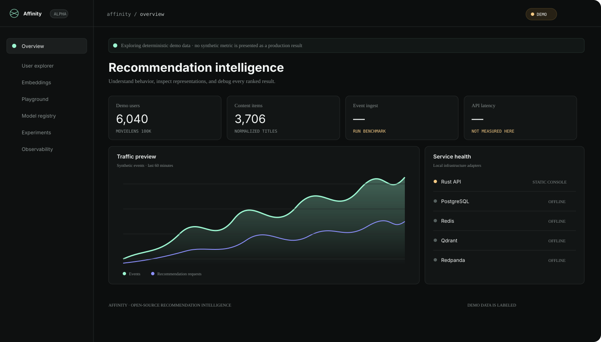
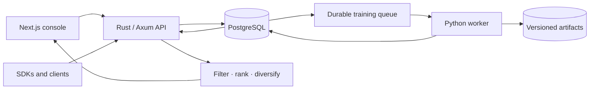

<div align="center">


### Understand users. Personalize everything.

An open-source recommendation platform for learning from behavior, training modern retrieval models, and explaining every ranked result.

[](https://github.com/jonxsong/Affinity/actions/workflows/ci.yml)
[](LICENSE)
[](services/api)
[](ml)
[](apps/web)

[Live console](https://affinity-recommendations.perkyaisle4.chatgpt.site) · [Architecture](docs/architecture.md) · [API](#api-surface) · [Contributing](CONTRIBUTING.md)

</div>



> [!NOTE]
> The hosted console is a static client with an explicit showcase fallback. Run the local stack for durable event ingestion, live user profiles, explained recommendations, experiments, and queued model training. Synthetic data is always labeled.

## Why Affinity

Recommendation systems are learning systems, not one `predict()` call. Affinity makes the full loop inspectable:

- **Behavioral foundation** — versioned events, batch ingestion, idempotency keys, schema validation, replay-ready storage, and dead-letter contracts.
- **Three modeling families** — implicit collaborative filtering, PyTorch two-tower retrieval, and GRU4Rec sequence modeling, all compared against popularity.
- **Transparent serving** — candidate retrieval, seen-item filtering, policy scoring, diversity, fallback behavior, model versioning, and human-readable explanations.
- **Research console** — inspect long/short-term interests, explore PCA projections, tune ranking weights, compare models, and design deterministic experiments.
- **Local-first operations** — PostgreSQL durability, Docker Compose, request tracing, health checks, and optional Redis, Qdrant, Redpanda, and MLflow extension points.

No OpenAI key—or any other paid API key—is required. Affinity’s online policy is implemented in Rust and its trainable recommenders use NumPy and PyTorch.

## Architecture

The first production shape is a modular monolith: Rust owns the low-latency online path; Python owns offline learning and evaluation; stable contracts keep the extraction path open if measurements justify it.


<details>
<summary><strong>Text-rendered data flow</strong></summary>



</details>

## Quick start

### Explore the console

```bash
corepack enable
pnpm install
pnpm dev
```

Open `http://localhost:3000`. Without the API, the console uses deterministic, clearly labeled showcase data; when the API is available it switches to live mode automatically.

### Run the complete local stack

```bash
docker compose up --build
```

| Service | URL | Purpose |
|---|---|---|
| Console | `localhost:3000` | Developer UI |
| API | `localhost:8080` | Events and recommendation orchestration |
| PostgreSQL | `localhost:5432` | Events, content, registry, experiments, and jobs |
| Qdrant | `localhost:6333` | Optional vector-retrieval extension |
| Redpanda | `localhost:9092` | Optional streaming extension |
| MLflow | `localhost:5000` | Enabled with the `training` profile |

Common workflows:

```bash
make setup       # install JS deps and pull service images
make dev         # start the local product
make seed        # generate labeled demo records
make train       # train the reproducible baseline
make evaluate    # compare models on one temporal protocol
make test        # web + Rust + Python suites
make benchmark   # k6 ingestion benchmark (local stack required)
```

Start the durable training worker and optional MLflow service with:

```bash
docker compose --profile training up --build
```

Admin mutations use `AFFINITY_ADMIN_TOKEN`; Compose supplies a development-only default. Set a strong value before exposing the API outside localhost.

## Repository map

```text
apps/web/                 Next.js 16 console with live API and showcase fallback
services/api/             Rust/Axum events, users, models, experiments, ranking
services/ml-service/      Container entrypoint for offline jobs
ml/affinity_ml/           datasets, features, models, evaluation, profiling
packages/contracts/       versioned cross-language JSON contracts
infrastructure/migrations PostgreSQL schema
benchmarks/               reproducible k6 workloads
docs/                     architecture, ADRs, and dataset policy
```

## ML system

| Model | Role | Implementation | Serving path |
|---|---|---|---|
| Popularity | cold-start floor | deterministic counts | versioned JSON artifact |
| Implicit SVD | collaborative baseline | NumPy factorization | compressed factor artifact |
| Two tower | representation learning | PyTorch contrastive loss | state-dict artifact |
| GRU4Rec | sequence intent | PyTorch GRU | state-dict artifact |

The training pipeline uses per-user temporal holdouts, trains all four model families, and records Recall@10/20, NDCG@10/20, MRR, catalog coverage, training time, and mean inference time. Each run writes immutable metrics, parameters, weights, dataset lineage, and a manifest under `artifacts/<run-id>`; with `DATABASE_URL` set, those records are also upserted into the model registry.

Run `make train` for the deterministic synthetic smoke workload or `python -m affinity_ml.training.pipeline --dataset movielens-100k` inside the ML container for the public benchmark. No benchmark number is presented without its generated artifact.

## Data and privacy

The initial public adapter uses [MovieLens 100K](https://grouplens.org/datasets/movielens/100k/). Downloads are explicit; archives and derived files are not committed. A separate seeded generator exercises streaming paths and is always labeled synthetic.

No generative model processes user behavior. Profiles and explanations are derived from observed interaction categories and explicit ranking components.

## API surface

```http
POST /v1/events                         # idempotent single ingest
POST /v1/events/batch                   # partial batch result, max 500
GET  /v1/users/{id}                     # safe profile metadata
GET  /v1/users/{id}/interests           # long-term and recent views
GET  /v1/users/{id}/history             # paginated private history
DELETE /v1/users/{id}                    # bearer-protected privacy deletion
GET  /v1/recommendations/{user_id}      # explained ranked list
GET  /v1/content/{content_id}/similar   # vector-similar candidates
GET  /v1/models                         # registry
POST /v1/models/train                   # bearer-protected admin operation
GET  /v1/experiments                    # deterministic experiment definitions
POST /v1/experiments                    # bearer-protected mutation
GET  /v1/experiments/{id}/assignment/{user_id}
GET  /v1/overview                       # live product and service summary
GET  /health · /ready · /metrics
```

Errors use a stable envelope with `code`, `message`, and `request_id`. Recommendation scores are labeled `heuristic_policy_score`; they are not represented as calibrated probabilities.

## Engineering decisions

- **Rust earns its place:** it owns validation, dedupe, concurrency, request policy, caching boundaries, and low-latency orchestration—not offline matrix math.
- **One protocol for fair comparison:** every model sees identical temporal partitions and candidate rules.
- **Simple before distributed:** [ADR-0001](docs/adr/0001-modular-monolith.md) keeps service boundaries explicit without making local development fragile.
- **No imaginary dashboards:** empty telemetry stays empty until the local services produce it.

## Validation

| Surface | Checks |
|---|---|
| Web | ESLint, strict TypeScript, Vitest, production static export |
| Rust | rustfmt, Clippy with warnings denied, unit/API/PostgreSQL integration tests |
| Python | Ruff, temporal leakage, deterministic seeds, full training-artifact smoke test, model shapes |
| Infrastructure | Compose validation and health contracts |

All required checks run in [GitHub Actions](https://github.com/jonxsong/Affinity/actions/workflows/ci.yml) without paid credentials.

## Known limitations

- The live Rust serving policy uses durable behavioral signals; trained SVD/two-tower/GRU artifacts are registered but are not yet loaded into the online candidate path.
- Redis, Qdrant, Redpanda, and MLflow are optional topology extension points, not dependencies of the current request path.
- The hosted `.chatgpt.site` build is a static console and cannot expose your local interaction history.
- No throughput or production-latency number is claimed yet.

## Roadmap

- [x] Typed event contract, idempotent PostgreSQL ingestion, and transparent Rust ranking
- [x] Collaborative, two-tower, and sequential model implementations
- [x] Interactive user, embedding, ranking, registry, experiment, and observability console
- [x] Reproducible temporal evaluation, versioned artifacts, and durable training worker
- [x] Durable Rust repository, migrations, privacy deletion, and integration coverage
- [ ] Qdrant export plus online ML inference client
- [ ] MovieLens model card with repeated-seed confidence intervals
- [ ] Measured ingestion and serving benchmarks across documented hardware

## Contributing

Issues and focused pull requests are welcome. Start with [CONTRIBUTING.md](CONTRIBUTING.md), keep metrics reproducible, and never present synthetic output as observed user behavior.

<div align="center">

Built to make recommendation engineering visible—from the first event to the final explanation.

</div>

