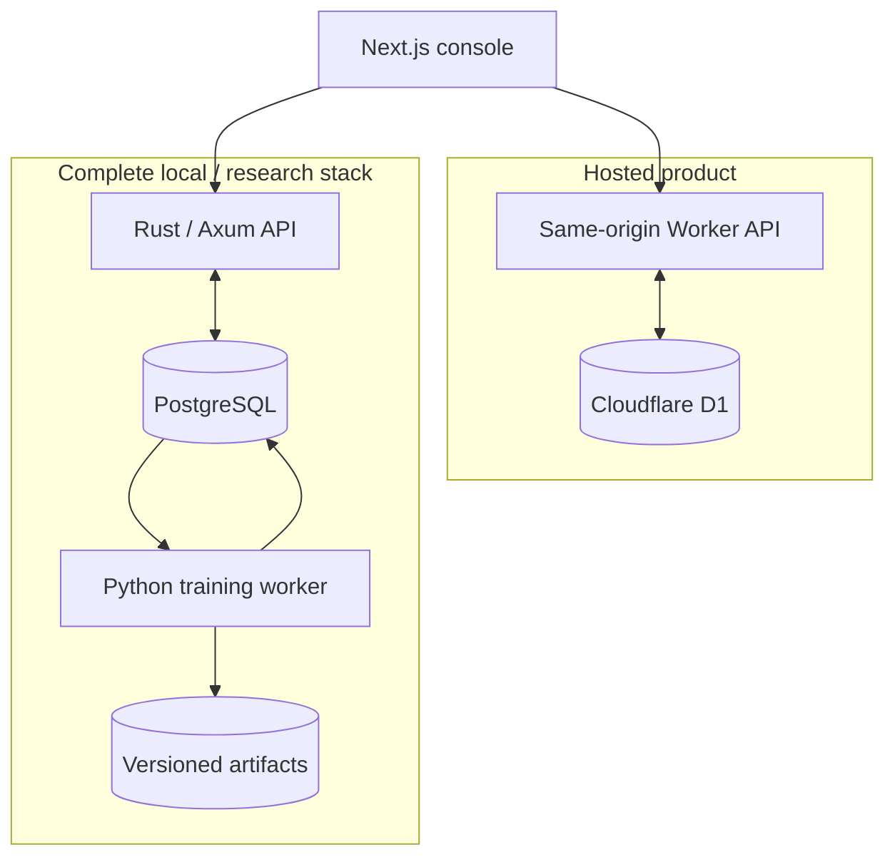

<div align="center">


### Understand users. Personalize everything.

An open-source recommendation platform for learning from behavior, training modern retrieval models, and explaining every ranked result.

[](https://github.com/jonxsong/Affinity/actions/workflows/ci.yml)
[](LICENSE)
[](services/api)
[](ml)
[](apps/web)

[Live console](https://affinity.jonzhang.dev) · [Architecture](docs/architecture.md) · [Operations](docs/operations.md) · [API](#api-surface) · [Contributing](CONTRIBUTING.md)

</div>


> [!NOTE]
> The hosted console is a working application, not a static mock: its same-origin Worker validates events, stores behavior in D1, and returns explained, personalized recommendations. The Docker stack provides the fuller Rust/PostgreSQL/Python research environment. Synthetic data is always labeled.

The live console is publicly accessible. Each browser receives a random local client identifier so anonymous visitors do not share behavioral history.

## Why Affinity

Recommendation systems are learning systems, not one `predict()` call. Affinity makes the full loop inspectable:

- **Behavioral foundation** — versioned events, batch ingestion, idempotency keys, schema validation, replay-ready storage, and dead-letter contracts.
- **Three modeling families** — implicit collaborative filtering, PyTorch two-tower retrieval, and GRU4Rec sequence modeling, all compared against popularity.
- **Transparent serving** — candidate retrieval, seen-item filtering, policy scoring, diversity, fallback behavior, model versioning, and human-readable explanations.
- **Research console** — inspect long/short-term interests, explore PCA projections, tune ranking weights, compare models, and design deterministic experiments.
- **Local-first operations** — PostgreSQL durability, Docker Compose, request tracing, health checks, and optional Redis, Qdrant, Redpanda, and MLflow extension points.

No OpenAI key—or any other paid API key—is required. Affinity’s online policy is implemented in Rust and its trainable recommenders use NumPy and PyTorch.

## Architecture

Affinity has two intentional deployment shapes. The hosted product uses a same-origin JavaScript Worker and D1 so the public console works without a separate server. The complete local/research stack is a modular monolith: Rust owns the low-latency online path, while Python owns offline learning and evaluation.


<details>
<summary><strong>Text-rendered data flow</strong></summary>



</details>

## Quick start

### Explore the console

```bash
corepack enable
pnpm install
pnpm dev
```

Open `http://localhost:3000`. For frontend-only work the console can use deterministic, clearly labeled showcase data; with the API available it switches to live mode automatically. The hosted deployment always calls its same-origin Worker API.

### Run the complete local stack

```bash
docker compose up --build
```

| Service | URL | Purpose |
|---|---|---|
| Console | `localhost:3000` | Developer UI |
| API | `localhost:8080` | Events and recommendation orchestration |
| PostgreSQL | `localhost:5432` | Events, content, registry, experiments, and jobs |
| Qdrant | `localhost:6333` | Optional vector-retrieval extension |
| Redpanda | `localhost:9092` | Optional streaming extension |
| MLflow | `localhost:5000` | Enabled with the `training` profile |

Common workflows:

```bash
make setup       # install JS deps and pull service images
make dev         # start the local product
make seed        # generate labeled demo records
make train       # train the reproducible baseline
make evaluate    # compare models on one temporal protocol
make test        # web + Rust + Python suites
make benchmark   # k6 ingestion benchmark (local stack required)
```

Start the durable training worker and optional MLflow service with:

```bash
docker compose --profile training up --build
```

Admin mutations use `AFFINITY_ADMIN_TOKEN`; Compose supplies a development-only default. Set a strong value before exposing the API outside localhost.

For an internet-facing self-hosted deployment, use the production override and follow the backup, restore, rollback, retention, incident, and rotation procedures in [`docs/operations.md`](docs/operations.md).

### Train and serve the online model

The Rust API can train a compact empirical-Bayes prior from durable behavioral events, store the portable artifact transactionally, and blend it into online ranking without a Python process in the request path:

```bash
curl -X POST http://localhost:8080/v1/models/train-serving \
  -H "Authorization: Bearer $AFFINITY_ADMIN_TOKEN" \
  -H "Content-Type: application/json" \
  -d '{"event_limit":100000}'
```

`GET /v1/models/active` reports the deployed artifact. `PUT /v1/models/active` accepts the same validated JSON contract used by the hosted Worker.

### Synchronize one user's events

Synchronization is explicit, authenticated, idempotent, and safe to repeat. It never silently merges the hosted and local data planes:

```bash
export AFFINITY_SOURCE_TOKEN="source-admin-token"
export AFFINITY_DESTINATION_TOKEN="destination-admin-token"
cargo run --release --manifest-path services/api/Cargo.toml \
  --bin affinity-sync -- \
  --source http://localhost:8080 \
  --destination https://affinity.jonzhang.dev \
  --user-id usr_example \
  --client-id web_your_browser_client_id
```

Tokens are read only from the environment and are never written to the export or command output.

## Repository map

```text
apps/web/                 Next.js 16 console with live API and showcase fallback
hosting/worker/           hosted same-origin API and static asset server
drizzle/                  hosted D1 migrations
services/api/             Rust/Axum events, users, models, experiments, ranking
services/ml-service/      Container entrypoint for offline jobs
ml/affinity_ml/           datasets, features, models, evaluation, profiling
packages/contracts/       versioned cross-language JSON contracts
infrastructure/migrations PostgreSQL schema
benchmarks/               reproducible k6 workloads
docs/                     architecture, ADRs, and dataset policy
```

## ML system

| Model | Role | Implementation | Serving path |
|---|---|---|---|
| Popularity | cold-start floor | deterministic counts | versioned JSON artifact |
| Implicit SVD | collaborative baseline | NumPy factorization | compressed factor artifact |
| Two tower | representation learning | PyTorch contrastive loss | state-dict artifact |
| GRU4Rec | sequence intent | PyTorch GRU | state-dict artifact |

The training pipeline uses per-user temporal holdouts, trains all four model families, and records Recall@10/20, NDCG@10/20, MRR, catalog coverage, training time, and mean inference time. Each run writes immutable metrics, parameters, weights, dataset lineage, and a manifest under `artifacts/<run-id>`; with `DATABASE_URL` set, those records are also upserted into the model registry.

Run `make train` for the deterministic synthetic smoke workload or `python -m affinity_ml.training.pipeline --dataset movielens-100k` inside the ML container for the public benchmark. No benchmark number is presented without its generated artifact.

## Data and privacy

The initial public adapter uses [MovieLens 100K](https://grouplens.org/datasets/movielens/100k/). Downloads are explicit; archives and derived files are not committed. A separate seeded generator exercises streaming paths and is always labeled synthetic.

No generative model processes user behavior. Profiles and explanations are derived from observed interaction categories and explicit ranking components.

## API surface

```http
POST /v1/events                         # idempotent single ingest
POST /v1/events/batch                   # partial batch result, max 500
GET  /v1/users/{id}                     # safe profile metadata
GET  /v1/users/{id}/interests           # long-term and recent views
GET  /v1/users/{id}/history             # paginated private history
DELETE /v1/users/{id}                    # bearer-protected privacy deletion
GET  /v1/recommendations/{user_id}      # explained ranked list
GET  /v1/content                        # active production catalog
PUT  /v1/content/{content_id}           # bearer-protected create/update
DELETE /v1/content/{content_id}          # bearer-protected archive
GET  /v1/content/{content_id}/similar   # vector-similar candidates
GET  /v1/models                         # registry
GET  /v1/models/active                  # active portable serving artifact
PUT  /v1/models/active                  # bearer-protected artifact activation
POST /v1/models/train-serving           # bearer-protected Rust online-model training
POST /v1/models/train                   # bearer-protected admin operation
GET  /v1/experiments                    # deterministic experiment definitions
POST /v1/experiments                    # bearer-protected mutation
GET  /v1/experiments/{id}/assignment/{user_id}
GET  /v1/overview                       # live product and service summary
GET  /v1/sync/export/{user_id}          # bearer-protected portable event export
POST /v1/sync/import                    # bearer-protected idempotent event import
POST /v1/admin/maintenance              # bearer-protected retention cleanup
GET  /health · /ready · /metrics
```

Errors use a stable envelope with `code`, `message`, and `request_id`. Recommendation scores are labeled `heuristic_policy_score`; they are not represented as calibrated probabilities.

## Engineering decisions

- **Rust earns its place:** it owns validation, dedupe, concurrency, request policy, caching boundaries, and low-latency orchestration—not offline matrix math.
- **One protocol for fair comparison:** every model sees identical temporal partitions and candidate rules.
- **Simple before distributed:** [ADR-0001](docs/adr/0001-modular-monolith.md) keeps service boundaries explicit without making local development fragile.
- **No imaginary dashboards:** empty telemetry stays empty until the local services produce it.

## Validation

| Surface | Checks |
|---|---|
| Web | ESLint, strict TypeScript, Vitest, Chromium end-to-end flows, production static export |
| Hosted API | Node test runner, Worker syntax check, D1 migration/deploy verification |
| Rust | rustfmt, Clippy with warnings denied, unit/API/PostgreSQL integration tests |
| Python | Ruff, temporal leakage, deterministic seeds, full training-artifact smoke test, model shapes |
| Infrastructure | Compose validation and health contracts |

### Measured local serving workload

The checked-in Rust runner alternates event ingestion and personalized recommendation reads. On commit `f9f75ae`, 1,000 requests at concurrency 16 completed with no failures on the documented Windows/Docker host: **4,121.6 requests/s**, **3.16 ms p50**, **5.67 ms p95**, and **24.48 ms p99**. This is a local smoke measurement, not a universal capacity claim. The full machine, workload, and result metadata is committed in [`benchmarks/results/2026-11-14-local.json`](benchmarks/results/2026-11-14-local.json).

Run the same workload against any deployment:

```bash
cargo run --release --manifest-path services/api/Cargo.toml \
  --bin affinity-benchmark -- \
  --base-url http://localhost:8080 --requests 1000 --concurrency 16
```

All required checks run in [GitHub Actions](https://github.com/jonxsong/Affinity/actions/workflows/ci.yml) without paid credentials.

## Scale boundaries

- The active online artifact is a portable behavioral prior. SVD, two-tower, and GRU4Rec remain offline comparison models until their candidate embeddings are exported into this serving contract.
- Redis, Qdrant, Redpanda, and MLflow are optional topology extension points, not dependencies of the current request path.
- Hosted D1 and local PostgreSQL are separate data planes; interaction history does not automatically replicate between them.
- The current catalog scan is intentional for the documented small-catalog deployment. Qdrant becomes required when candidate volume makes bounded in-memory scoring unsuitable.

## Roadmap

- [x] Typed event contract, idempotent PostgreSQL ingestion, and transparent Rust ranking
- [x] Collaborative, two-tower, and sequential model implementations
- [x] Interactive user, embedding, ranking, registry, experiment, and observability console
- [x] Reproducible temporal evaluation, versioned artifacts, and durable training worker
- [x] Durable Rust repository, migrations, privacy deletion, and integration coverage
- [x] Portable trained-model artifact loaded by the Rust API and hosted Worker
- [x] Authenticated, idempotent hosted/local event synchronization
- [x] Reproducible mixed serving benchmark with checked-in hardware metadata
- [x] Durable public quotas, self-service deletion, retention maintenance, and browser security policy
- [x] Authenticated content create/update/archive without an application redeploy
- [x] Chromium release gates for the public playground and event-write paths
- [x] Backup/restore, rollback, incident, retention, SLO, and secret-rotation runbooks
- [ ] Qdrant export for high-cardinality learned candidate retrieval
- [ ] MovieLens model card with repeated-seed confidence intervals
- [ ] Repeated benchmarks across additional documented hardware

## Contributing

Issues and focused pull requests are welcome. Start with [CONTRIBUTING.md](CONTRIBUTING.md), keep metrics reproducible, and never present synthetic output as observed user behavior.

<div align="center">

Built to make recommendation engineering visible—from the first event to the final explanation.

</div>

