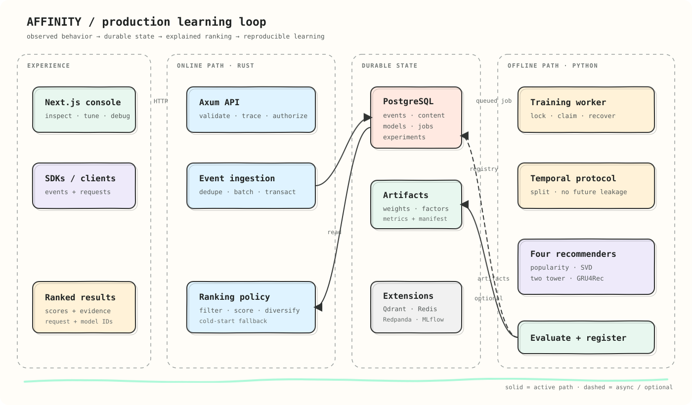
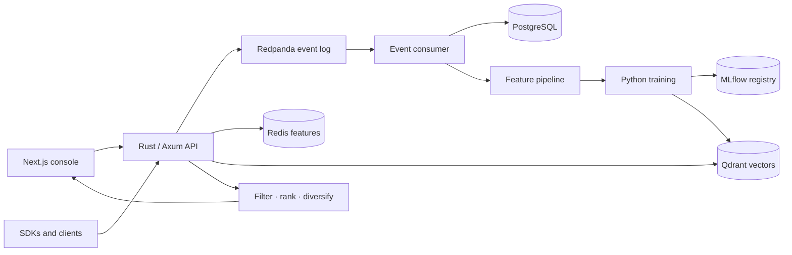

<div align="center">

# ◇ Affinity

### Understand users. Personalize everything.

An open-source recommendation platform for learning from behavior, training modern retrieval models, and explaining every ranked result.

[](https://github.com/jonxsong/Affinity/actions/workflows/ci.yml)
[](LICENSE)
[](services/api)
[](ml)
[](apps/web)

[Live console](https://affinity-recommendations.perkyaisle4.chatgpt.site) · [Architecture](docs/architecture.md) · [API](#api-surface) · [Contributing](CONTRIBUTING.md)

</div>


> [!NOTE]
> The hosted console is a safe, static research demo. Public-dataset and synthetic values are labeled. Run the local stack to ingest events, train models, and collect real measurements.

## Why Affinity

Recommendation systems are learning systems, not one `predict()` call. Affinity makes the full loop inspectable:

- **Behavioral foundation** — versioned events, batch ingestion, idempotency keys, schema validation, replay-ready storage, and dead-letter contracts.
- **Three modeling families** — implicit collaborative filtering, PyTorch two-tower retrieval, and GRU4Rec sequence modeling, all compared against popularity.
- **Transparent serving** — candidate retrieval, seen-item filtering, policy scoring, diversity, fallback behavior, model versioning, and human-readable explanations.
- **Research console** — inspect long/short-term interests, explore PCA projections, tune ranking weights, compare models, and design deterministic experiments.
- **Local-first operations** — PostgreSQL, Redis, Qdrant, Redpanda, MLflow, OpenTelemetry-ready services, Docker Compose, and no required paid API.

## Architecture

The first production shape is a modular monolith: Rust owns the low-latency online path; Python owns offline learning and evaluation; stable contracts keep the extraction path open if measurements justify it.



<details>
<summary><strong>Text-rendered data flow</strong></summary>



</details>

## Quick start

### Explore the console

```bash
corepack enable
pnpm install
pnpm dev
```

Open `http://localhost:3000`. The console works immediately with deterministic, clearly labeled demo data.

### Run the complete local stack

```bash
cp .env.example .env
docker compose up --build
```

| Service | URL | Purpose |
|---|---|---|
| Console | `localhost:3000` | Developer UI |
| API | `localhost:8080` | Events and recommendation orchestration |
| Qdrant | `localhost:6333` | Vector retrieval |
| Redpanda | `localhost:9092` | Durable event log |
| MLflow | `localhost:5000` | Enabled with the `training` profile |

Common workflows:

```bash
make setup       # install JS deps and pull service images
make dev         # start the local product
make seed        # generate labeled demo records
make train       # train the reproducible baseline
make evaluate    # compare models on one temporal protocol
make test        # web + Rust + Python suites
make benchmark   # k6 ingestion benchmark (local stack required)
```

## Repository map

```text
apps/web/                 Next.js 16 console, static export for hosted demo
services/api/             Rust/Axum events, users, models, experiments, ranking
services/ml-service/      Container entrypoint for offline jobs
ml/affinity_ml/           datasets, features, models, evaluation, profiling
packages/contracts/       versioned cross-language JSON contracts
infrastructure/migrations PostgreSQL schema
benchmarks/               reproducible k6 workloads
docs/                     architecture, ADRs, and dataset policy
```

## ML system

| Model | Role | Implementation | Serving path |
|---|---|---|---|
| Popularity | cold-start floor | deterministic counts | Rust fallback |
| Implicit SVD | collaborative baseline | NumPy factorization | exported factors |
| Two tower | semantic retrieval | PyTorch contrastive loss | Qdrant nearest neighbors |
| GRU4Rec | session intent | PyTorch GRU | ML inference service |

The evaluator uses per-user temporal holdouts. Test interactions never enter training features. It reports Recall@10/20, NDCG@10/20, MRR, coverage, diversity, cold-start quality, training time, and inference latency as each model path is enabled.

### Verified smoke evaluation

These numbers are **actual measurements from the deterministic synthetic fixture** (`seed=42`, 32 users, 64 items, 12 interactions/user). They validate the pipeline; they are not MovieLens or production benchmarks.

| Model | Recall@10 | NDCG@10 | MRR | Catalog coverage |
|---|---:|---:|---:|---:|
| Popularity | 0.0000 | 0.0000 | 0.0000 | 0.2188 |
| Implicit SVD (16 factors) | 0.5625 | 0.2917 | 0.2087 | 1.0000 |

Run `make evaluate` on your hardware for a timestamped result. Ingestion and API latency remain deliberately unreported until `make benchmark` is run with hardware, concurrency, duration, and configuration captured together.

## Data and privacy

The initial public adapter uses [MovieLens 100K](https://grouplens.org/datasets/movielens/100k/). Downloads are explicit; archives and derived files are not committed. A separate seeded generator exercises streaming paths and is always labeled synthetic.

The optional LLM profiler is off by default. When configured, its structured profiles separate observed evidence from inferred hypotheses, forbid sensitive-attribute inference, carry a profile version, and never gate the core recommender.

## API surface

```http
POST /v1/events                         # idempotent single ingest
POST /v1/events/batch                   # partial batch result, max 500
GET  /v1/users/{id}                     # safe profile metadata
GET  /v1/users/{id}/interests           # long-term and recent views
GET  /v1/users/{id}/history             # paginated private history
GET  /v1/recommendations/{user_id}      # explained ranked list
GET  /v1/content/{content_id}/similar   # vector-similar candidates
GET  /v1/models                         # registry
POST /v1/models/train                   # bearer-protected admin operation
GET  /v1/experiments                    # deterministic experiment definitions
POST /v1/experiments                    # bearer-protected mutation
GET  /health · /ready · /metrics
```

Errors use a stable envelope with `code`, `message`, and `request_id`. Recommendation scores are labeled `heuristic_policy_score`; they are not represented as calibrated probabilities.

## Engineering decisions

- **Rust earns its place:** it owns validation, dedupe, concurrency, request policy, caching boundaries, and low-latency orchestration—not offline matrix math.
- **One protocol for fair comparison:** every model sees identical temporal partitions and candidate rules.
- **Simple before distributed:** [ADR-0001](docs/adr/0001-modular-monolith.md) keeps service boundaries explicit without making local development fragile.
- **No imaginary dashboards:** empty telemetry stays empty until the local services produce it.

## Validation

| Surface | Checks |
|---|---|
| Web | ESLint, strict TypeScript, production static export |
| Rust | rustfmt, Clippy with warnings denied, unit/API tests |
| Python | Ruff, temporal leakage tests, metric examples, reproducibility, model-shape smoke tests |
| Infrastructure | Compose validation and health contracts |

All required checks run in [GitHub Actions](https://github.com/jonxsong/Affinity/actions/workflows/ci.yml) without paid credentials.

## Known limitations

- PostgreSQL/Redis/Qdrant adapters are defined by the local topology and schemas; the checked-in Rust demo repository is in-memory while durable adapters are completed.
- Deep models are implementation-ready but no pretrained artifact is committed. Run training against MovieLens before comparing them.
- The hosted `.chatgpt.site` build is a static console and cannot expose your local interaction history.
- No throughput or production-latency number is claimed yet.

## Roadmap

- [x] Typed event contract, idempotent ingestion, and transparent demo ranking
- [x] Collaborative, two-tower, and sequential model implementations
- [x] Interactive user, embedding, ranking, registry, experiment, and observability console
- [x] Reproducible temporal evaluation and local infrastructure
- [ ] Durable Rust storage adapters and replay worker
- [ ] Qdrant export plus online ML inference client
- [ ] MovieLens model card with repeated-seed confidence intervals
- [ ] Measured ingestion and serving benchmarks across documented hardware

## Contributing

Issues and focused pull requests are welcome. Start with [CONTRIBUTING.md](CONTRIBUTING.md), keep metrics reproducible, and never present synthetic output as observed user behavior.

<div align="center">

Built to make recommendation engineering visible—from the first event to the final explanation.

</div>

